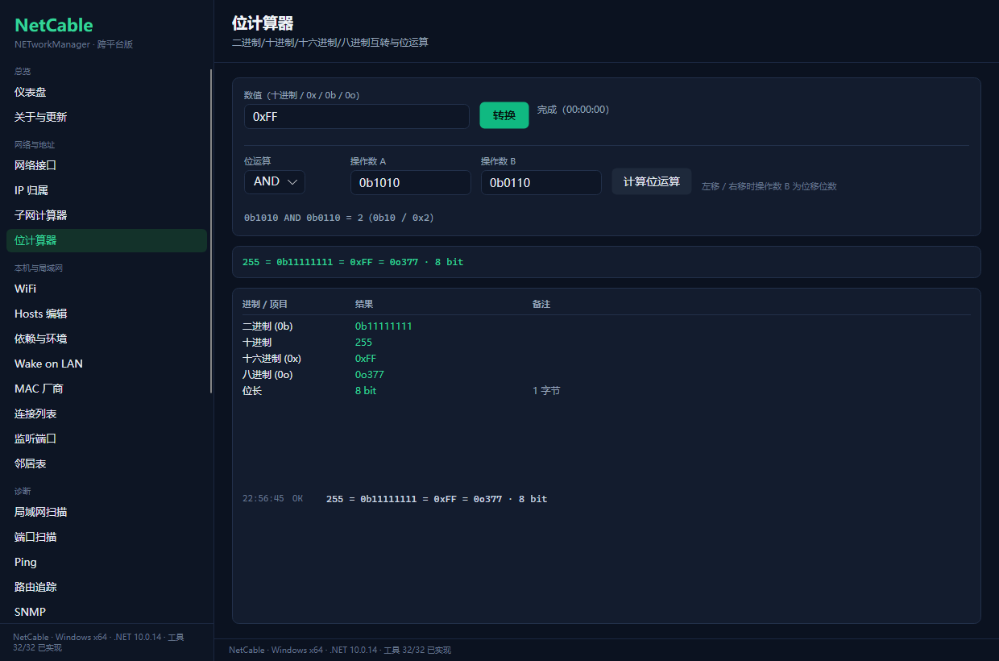
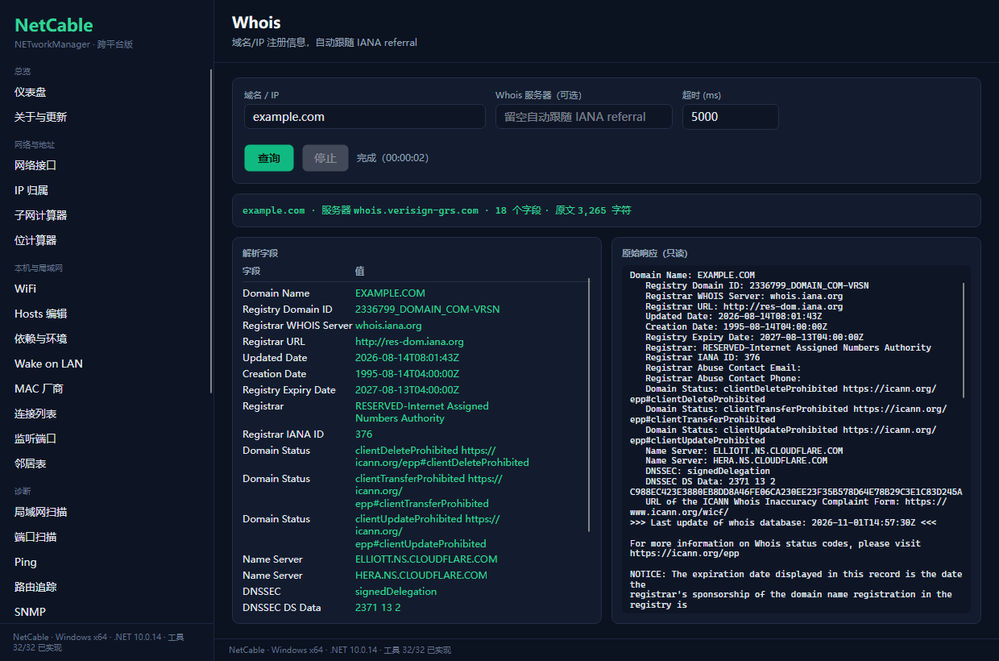
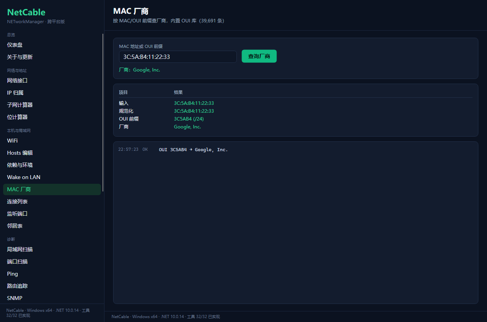
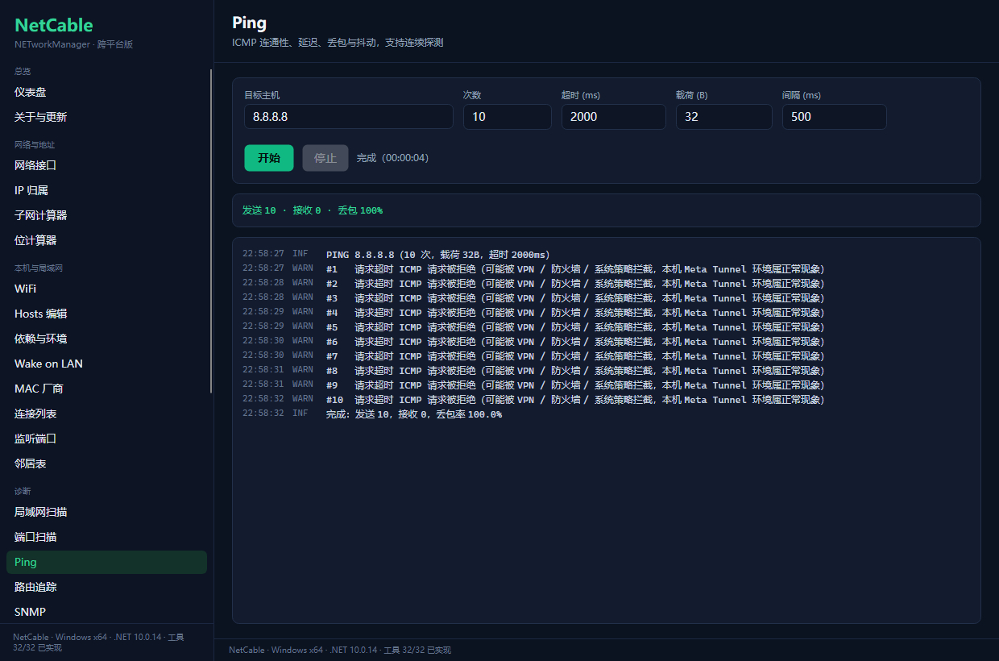
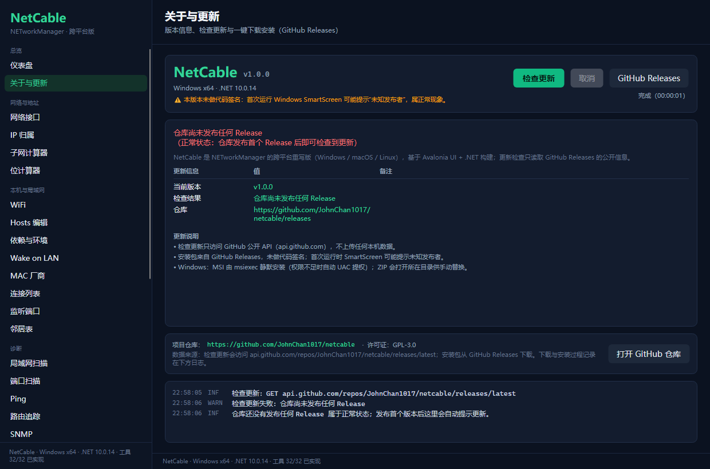

# NetCable · 跨平台网络工具箱

> **NETworkManager 的三端移植版**：把原本 Windows-only 的 .NET/WPF 网络管理套件，
> 用 **.NET 10 + Avalonia** 重写成 **Windows / macOS / Linux** 都能跑的原生桌面应用。
>
> 上游：[BornToBeRoot/NETworkManager](https://github.com/BornToBeRoot/NETworkManager)（GPL-3.0，8.8k★）



---

## 为什么有这个项目

[NETworkManager](https://github.com/BornToBeRoot/NETworkManager) 是桌面端最全能的网络工具箱（28 个内置工具），
但它是 **WPF + 全部项目 `net10.0-windows`**，只能跑在 Windows 上：

| 指标 | 上游 |
| --- | --- |
| C# / XAML | 99,141 行 / 41,622 行 |
| 项目 | 13 个，全部 `net10.0-windows` |
| UI | WPF + MahApps.Metro + Dragablz + WebView2 + LiveCharts.WPF |
| Windows 专属 | MSTSCLib(RDP ActiveX)、PowerShell SDK、CsWinRT、WinForms |

NetCable 的路线：**UI 层用 Avalonia 重写，业务能力重新组织为跨平台服务层**，
Windows 专属能力（RDP/VNC/PowerShell/防火墙）改为"调用系统原生客户端"。

详细拆解与工时评估见 [docs/porting-plan.md](docs/porting-plan.md)。

---

## 功能（32 个工具：上游 28 个全部还原 + 4 个增强）

**上游 NETworkManager 的 28 个内置工具已全部还原**，另加 4 个增强工具（测速、HTTP/TLS 检查、依赖与环境、关于与更新）。

| 分组 | 工具 |
| --- | --- |
| 总览 | 仪表盘 |
| 网络与地址 | 网络接口 · IP 归属 · 子网计算器 · 位计算器 |
| 诊断 | Ping · 路由追踪 · 端口扫描 · 局域网扫描 · **SNMP** · NTP 时间 · **Discovery Protocol(LLDP/CDP)** · **测速** · **HTTP/TLS** |
| 查询 | DNS 查询 · Whois · RDAP |
| 总览 | 仪表盘 · **关于与更新**（版本 / 检查更新 / 下载安装） |
| 本机与局域网 | WiFi · **Hosts 编辑** · **依赖与环境**（Npcap/Wireshark/dumpcap/pktmon 检测与引导安装） · 连接列表 · 监听端口 · 邻居表 · Wake on LAN · MAC 厂商库 |
| 远程与集成 | **远程桌面(RDP)** · **SSH/PuTTY** · **VNC** · **PowerShell** · **Web 控制台** · **防火墙** |

> LLDP/CDP 抓包不需要 Wireshark：只装 **Npcap** 即可（或装 Wireshark 用其自带 dumpcap，或管理员运行走 Windows 内置 pktmon）。
> 详见 [docs/capture-backends.md](docs/capture-backends.md)。

远程客户端类工具统一采用"**检测本机客户端 → 生成命令 → 一键启动**"模式，不内置协议实现，
三端都不会瘸：Windows 用 `mstsc`/`powershell`/OpenSSH，macOS 用 `open`/`osascript`，Linux 用 `xfreerdp`/`x-terminal-emulator`/`vncviewer`。


<table>
<tr>
<td width="50%"><br/><sub>Whois：解析字段 + 原始响应双栏</sub></td>
<td width="50%"><br/><sub>MAC 厂商：内置 OUI 库 39,691 条</sub></td>
</tr>
<tr>
<td width="50%"><br/><sub>Ping：流式逐包日志 + 丢包/抖动统计</sub></td>
<td width="50%"><br/><sub>关于与更新：版本、检查更新、一键下载安装</sub></td>
</tr>
</table>

---
## 技术架构

```
NetCable.slnx
├─ src/NetCable.Core            跨平台基础层（net10.0，零 UI 依赖）
│   ├─ Contracts/               服务接口（IPingService、IDnsLookupService、IWifiService…）
│   ├─ Models/                  DTO
│   ├─ Platform/                OS 判定 + ProcessRunner（外部命令，超时/取消/流式）
│   ├─ Utils/                   SubnetCalculator / OuiLookup / PortServiceLookup
│   └─ Resources/               复用上游数据：OUI.xml(3.8MB, 39,691 条)、Ports.xml、WhoisServers.xml
├─ src/NetCable.Services.Network    Ping / Traceroute / PortScanner / HostScanner / WakeOnLan
├─ src/NetCable.Services.Lookup     DNS / Whois / RDAP / IP 归属 / SNTP / HTTP-TLS / SpeedTest
├─ src/NetCable.Services.Platform   网卡 / 网关 / DNS / WiFi / 连接 / 监听 / 邻居表
├─ src/NetCable.Desktop         Avalonia UI（三端单工程，32 个工具页）
├─ tools/NetCable.Cli           命令行版（同一套服务层，无需 UI）
└─ tests/NetCable.Tests         Core 单元测试（12 项）
```

规模：**175 个文件 / 16,018 行**（C# + XAML），服务层 48 文件 / 10,136 行，Core 单测 16 项 + 服务层自测 163 项断言。

设计要点：

- **约定式挂载**：`[ToolPage("ping")]` + `ViewLocator`（`XxxViewModel`→`XxxView`），
  新增工具 = 新增两个文件，**不改任何共享文件** → 多人并行开发零合并冲突（本项目 5 个 agent 并行验证了这一点）。
- **统一工具基类**：`ToolViewModelBase` 提供 `Run/Cancel/IsRunning/Log/Rows/StatusText`，
  所有页面共享 `Controls/LogView` 与 `Controls/ResultTable`。
- **平台差异收敛在服务层**：UI 不知道自己在哪个系统上。
- **Core 可单独构建**：`pwsh -File scripts/build.ps1 -Project src/NetCable.Core`，便于在 Linux/macOS CI 里跑。

### 平台适配策略（举例）

| 能力 | Windows | macOS | Linux |
| --- | --- | --- | --- |
| Ping | .NET 托管 ICMP | 系统 `ping`（解析 `time=`） | 系统 `ping` |
| Traceroute | `tracert -d` | `traceroute -n` | `traceroute` / `tracepath` |
| 邻居表 | `arp -a` | `arp -an` | `ip neigh` / `/proc/net/arp` |
| 连接列表 | `netstat -ano` | `netstat -anv` + `lsof` | `ss -tunap` / `netstat` |
| WiFi | `netsh wlan` | `airport` + `system_profiler -json` | `nmcli` + `iw` |
| 系统 DNS | `ipconfig /all` | `scutil --dns` | `/etc/resolv.conf` / `resolvectl` |

---

## 下载与安装

三端均为**自包含发布**（自带 .NET 运行时，目标机器无需安装 .NET）。

| 类型 | 文件 | 大小 | 用法 |
| --- | --- | --- | --- |
| Windows 绿色版 | `NetCable-1.0.0-win-x64-portable.zip` | 46.8 MB | 解压即用，双击 `NetCable.exe` |
| **Windows MSI** | `NetCable-1.0.0-win-x64.msi` | **38.9 MB** | 双击安装（WiX 向导，perUser 不需要管理员，进「应用和功能」可卸载） |
| Windows 安装版 | `NetCable-1.0.0-win-x64-setup.zip` | 46.8 MB | 解压后双击 `安装.bat`（脚本安装，效果等价） |
| Linux | `NetCable-1.0.0-linux-x64.tar.gz` | 43.3 MB | `tar -xzf` 后执行 `./netcable.sh` |
| macOS (Apple Silicon) | `NetCable-1.0.0-osx-arm64.tar.gz` | 43.5 MB | `tar -xzf` 后执行 `./netcable.sh` |

打包命令：`pwsh -File scripts/package.ps1`，产物在 `.dist/`。
细节、实现坑与分发注意事项见 [docs/packaging.md](docs/packaging.md)。

> 未做代码签名：Windows SmartScreen 首次运行会提示"未知发布者"，点「更多信息 → 仍要运行」即可。

---

## 快速开始

### 正常联网环境（推荐）

```bash
# 需要 .NET 10 SDK
dotnet build src/NetCable.Desktop/NetCable.Desktop.csproj
dotnet run  --project src/NetCable.Desktop
```

macOS / Linux 上同样两条命令即可（Avalonia 自动选择原生后端）。

### 本机（离线/沙箱环境）

本机有两个限制：系统 TLS 不可用（NuGet 只能走离线源）、MSBuild 多节点被沙箱拦截。
构建脚本已封装好：

```powershell
pwsh -File scripts/build.ps1                           # 构建桌面应用
pwsh -File scripts/test.ps1                            # Core 单元测试
pwsh -File scripts/verify.ps1                          # 全部工具页截图冒烟
pwsh -File scripts/verify.ps1 -Publish                 # 三端交叉发布验证（win/linux/osx）

src\NetCable.Desktop\bin\Debug\net10.0\NetCable.exe    # 运行
```

详见 [docs/build-notes.md](docs/build-notes.md)。

### 命令行版

同一套服务层，无 UI 依赖：

```powershell
tools\NetCable.Cli\bin\Debug\net10.0\NetCable.Cli.exe --help
NetCable.Cli.exe scan   192.168.1.0/24
NetCable.Cli.exe ports  192.168.1.1 80,443,22
NetCable.Cli.exe dns    example.com MX
NetCable.Cli.exe whois  example.com
NetCable.Cli.exe subnet 192.168.1.100/24
```

### 无头截图 / UI 回归

应用内置截图模式，不依赖窗口是否在前台：

```powershell
NetCable.exe --screenshot=out.png             # 渲染窗口到 PNG 后退出
NetCable.exe --tool=traceroute                # 启动时定位到某工具
NetCable.exe --tool=ping --autorun            # 自动点一次"开始"（冒烟测试）
```

---

## 隐私说明

- 本仓库**不含**任何真实环境信息：示例 IP 使用 `192.168.1.x`、示例 MAC 使用公开 OUI（`3C:5A:B4`）、文档中的主机名/SSID 均为占位符。
- 应用本身**不上传任何数据**：所有探测在本机执行；仅「检查更新」与「依赖下载引导」会访问 GitHub / 厂商官网。
- 应用内的 IP 归属、Whois/RDAP 查询会把目标地址发给相应公共服务（ip-api.com / rdap.org / IANA），这是功能所需。

## 文档

| 文档 | 内容 |
| --- | --- |
| [docs/porting-plan.md](docs/porting-plan.md) | 移植可行性分析、28 工具移植矩阵、里程碑 |
| [docs/build-notes.md](docs/build-notes.md) | 本机构建环境踩坑（TLS/MSBuild/沙箱/ICMP） |
| [docs/capture-backends.md](docs/capture-backends.md) | LLDP/CDP 抓包后端说明（Npcap / dumpcap / tcpdump / pktmon） |
| [docs/wifi-capture.md](docs/wifi-capture.md) | WiFi / 802.11 管理帧：能力矩阵、提权流程、monitor mode 前提 |
| [docs/packaging.md](docs/packaging.md) | 打包与分发：绿色版/安装版、大小、签名与已知坑 |
| [docs/ip-tools-alternatives.md](docs/ip-tools-alternatives.md) | 选型报告：IP Tools 的跨平台替代品对比 |

---

## 与上游的关系

- 本项目是 [NETworkManager](https://github.com/BornToBeRoot/NETworkManager) 的**独立重写分支**，
  复用了其工具设计、数据资源（OUI/端口/Whois 服务器表）与视觉语言。
- 上游与本项目均为 **GPL-3.0**，分发时请保留原作者版权与许可证。
- 上游 WPF 代码未直接复制（目标框架与 UI 栈不同），业务语义按需重新实现。

## 已知限制

- M1 的三端验证为**交叉编译 + RID 发布**，未在 macOS/Linux 真机运行；平台分支按官方命令手册实现，需要真机回归。
- 本机 Meta Tunnel（TUN 代理）会吞 ICMP、劫持 DNS → Ping/端口扫描在本机结果不可信（环境问题，系统 `ping` 同样失败）。
  局域网扫描已针对该环境加了"直连校验"（用 TCP 连接的本端地址判断是否经代理），避免假阳性。
- Windows 11 24H2 起非管理员无法读取 WLAN 信息，WiFi 页会给出明确提示。
- 远程客户端类工具（RDP/VNC/PowerShell）依赖本机已安装的客户端，M2 实现。
